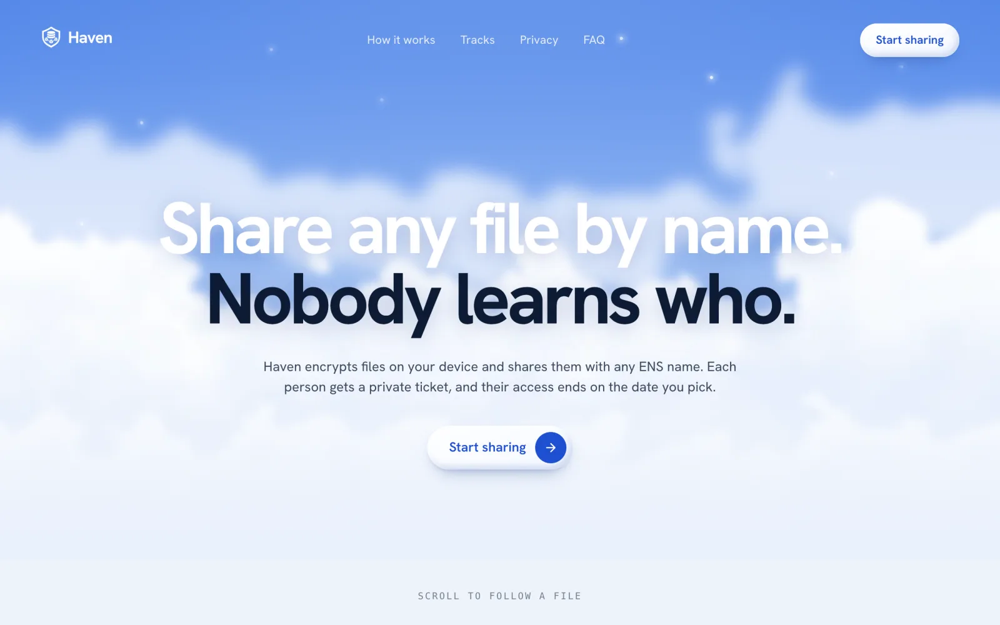
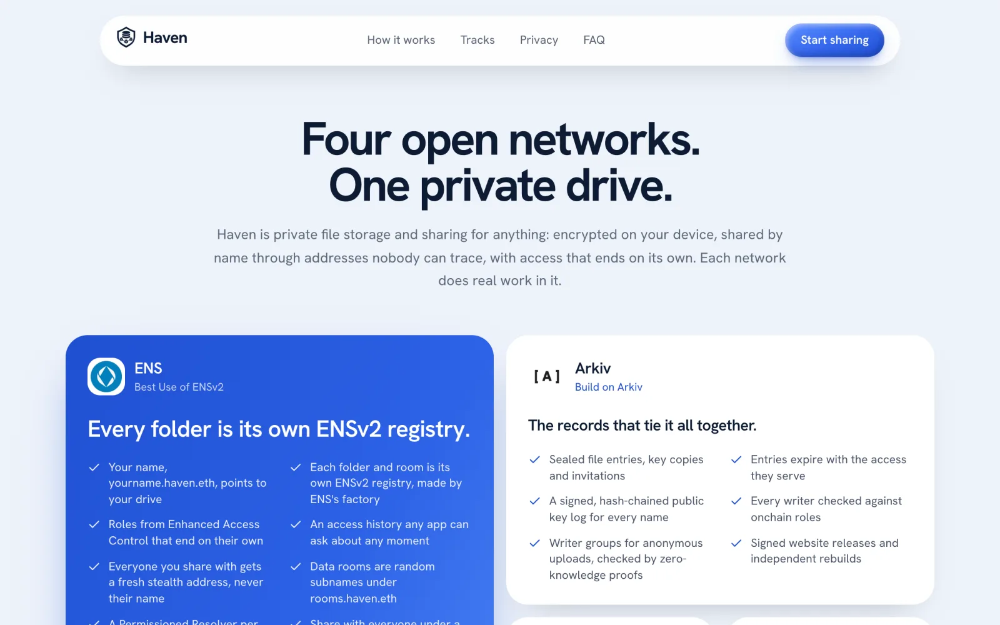
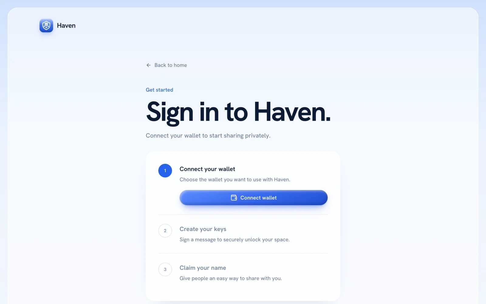
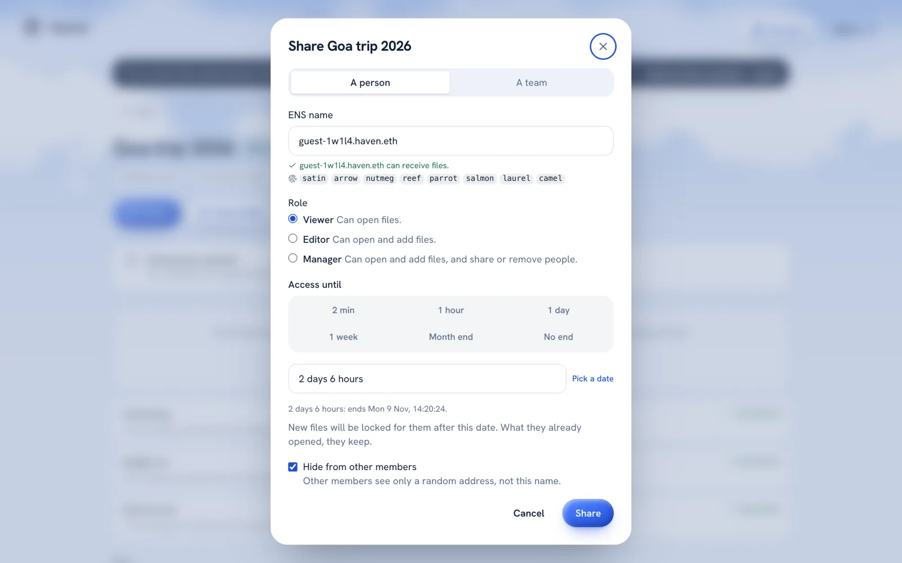
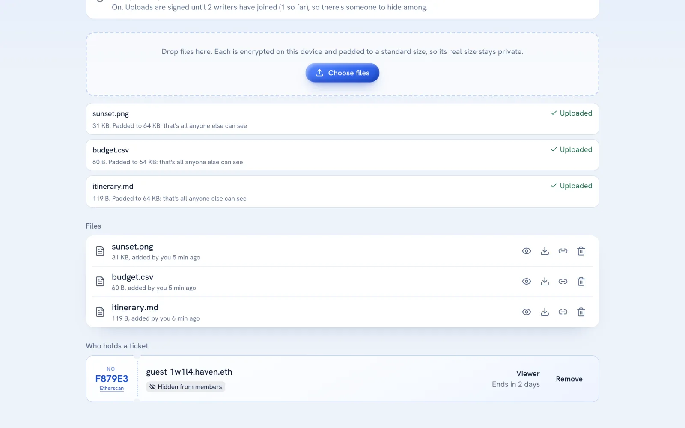
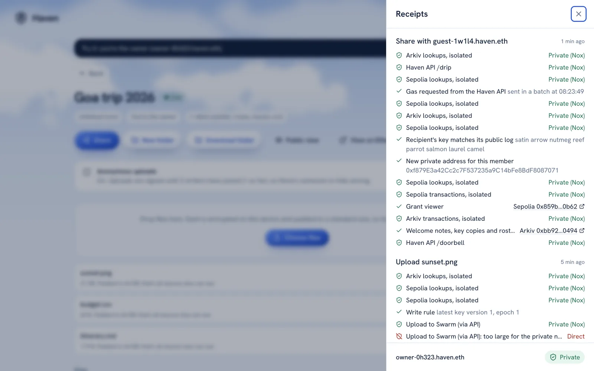
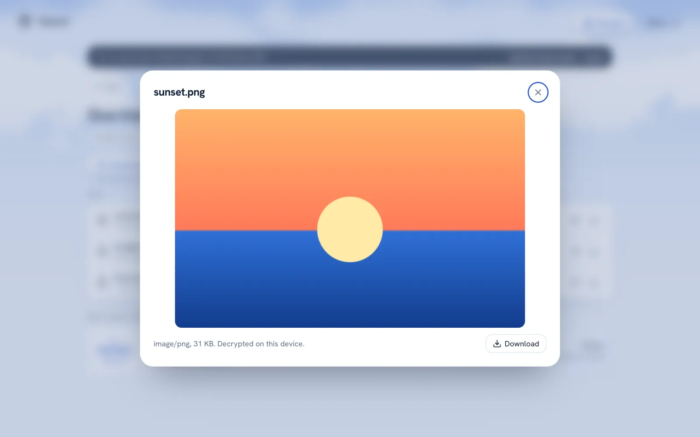

<h1 align="center">Haven</h1>

<p align="center"><b>Share any file by ENS name. Nobody learns who.</b></p>

<p align="center">
Private file storage and sharing: files are encrypted on your device, shared with an ENS name through a fresh stealth
address, and access ends on the date you pick. Built on ENSv2, Arkiv, Swarm and Anon-RPC.
</p>

<p align="center">
<a href="https://havenethglobal.xyz"><b>Open Haven</b></a> ·
<a href="docs/DEMO.md">Demo guide</a> ·
<a href="docs/protocol.md">Protocol</a> ·
<a href="LICENSE">MIT</a>
</p>

---

## About

- **Share by name:** type an ENS name, pick a role (viewer, editor, manager) and an end date. That's the whole flow.
- **Access that ends on its own:** roles are granted with `grantRolesUntil` on an ENSv2 registry, so they expire onchain
  without anyone sending a transaction.
- **Private membership:** every share goes to a new Fluidkey stealth address, so the chain never lists who you shared with.
- **Unlinked rooms:** a room gets a random name under `rooms.haven.eth` and its own key, so it can't be tied to your drive.
- **Encrypted, padded files:** files are encrypted in the browser, padded to fixed sizes and stored on Swarm. Arkiv holds
  only sealed entries pointing at them.
- **Private lookups:** chain and database reads go through Anon-RPC, with a separate route for each room and address.
- **Receipts for everything:** each action lists its transactions with Etherscan and Arkiv explorer links, and flags any
  request that had to go direct.
- **Public view:** see exactly what anyone can read about a folder, next to what you see with your keys.
- **Teams and groups:** share a folder with a group of ENS names, or with every subname under a name like `acme.eth`.
- **Anonymous uploads:** once two writers have joined, Semaphore proofs let a member upload without revealing which one.
- **Works on phones:** installable web app; on Android, "Share to Haven" from any app.
- **Try it without a wallet:** two fresh identities in one tab, each with a real name on Sepolia.

> [!NOTE]
> Haven runs on test networks: **Sepolia** (ENSv2), **Arkiv's Rabdi testnet** and **Swarm**. Gas for names, rooms and
> shares is covered by the Haven API. Nothing is mocked or pre-seeded: every value on screen is read live, and every
> transaction links to its explorer.

Built at **ETHGlobal Mumbai 2026** for: **ENS** (Best use of ENSv2) · **Arkiv** (Build on Arkiv, plus the Swarm bonus) ·
**Ethereum Foundation** (Anon-RPC, CROPS).

---

## Screenshots

<table>
  <tr>
    <td width="50%"><br><sub>Home</sub></td>
    <td width="50%"><br><sub>One drive, four networks</sub></td>
  </tr>
  <tr>
    <td><br><sub>Sign in with a wallet, or try it without one</sub></td>
    <td><br><sub>Share by ENS name, with a key check and an end date</sub></td>
  </tr>
  <tr>
    <td><br><sub>A room: padded files and each member's ticket</sub></td>
    <td><br><sub>Receipts: every step, private or direct, with explorer links</sub></td>
  </tr>
  <tr>
    <td><br><sub>The recipient opens a file, decrypted on their device</sub></td>
    <td><br><sub>Public view: what anyone can see, next to what you see</sub></td>
  </tr>
</table>

---

## Try it

- **Website:** [havenethglobal.xyz](https://havenethglobal.xyz). Sign in with a wallet, or press **Try it** for two
  identities in one tab (an owner and a recipient).
- **Phone:** open the website, then Settings → **Install the app**.
- **Demo script:** [`docs/DEMO.md`](docs/DEMO.md) walks through every feature, track by track.

---

## How it works

```
 browser / phone                                                     public networks
 ┌───────────────────────────────┐   Anon-RPC (Nym/Nox/Tor)   ┌─────────────────────────────────────┐
 │ keys from one signature       │ ─────────────────────────▶ │ Sepolia: ENSv2 names, DriveRegistry │
 │ AES-256-GCM, padded buckets   │   one isolation key per    │   roles that end, access history    │
 │ stealth addresses (Fluidkey)  │   room and stealth address │ Arkiv: sealed file index, welcome   │
 │ validator for every entity    │                            │   notes, key copies, rosters        │
 └───────────────┬───────────────┘                            └─────────────────────────────────────┘
                 │ signed upload / ciphertext download         ┌─────────────────────────────────────┐
                 └───────────────▶ apps/api (relayer) ───────▶ │ Swarm: padded ciphertext            │
                                   /claim /room /drip          └─────────────────────────────────────┘
                                   /arkiv-rpc /upload /bytes
```

1. **Sign in.** With a supported wallet, you sign a domain-bound message (SIWE); a new wallet signs the same message
   twice to check its signatures are stable. Haven derives your private keys on the device. **Try it** uses local random
   identities instead.
2. **Get a name.** Claim `you.haven.eth` for free (the API pays the gas and keeps no role on your new resolver or
   drive root), or link an ENSv2 name you control. Haven publishes a signed public key log for sharing; claimed names
   also publish a `haven.key` resolver record.
3. **Make a folder.** Every folder is an ENS name whose subregistry is a `DriveRegistry`, our one contract. A folder is
   either in your drive (`f-….you.haven.eth`) or an unlinked room (`r-….rooms.haven.eth`).
4. **Upload.** Files are encrypted and padded to fixed size buckets in the browser, then stored on Swarm. Arkiv gets a
   sealed entry pointing at the ciphertext.
5. **Share.** Type an ENS name and an end date. Haven:
   - derives a stealth address for the recipient;
   - grants it a role that ends on its own (`grantRolesUntil`);
   - funds it with gas dust if it's an editor or manager (viewers send no transactions);
   - leaves a sealed welcome note on Arkiv that only the recipient can find.
6. **Access ends.** Each folder's key changes every epoch, and keys only chain backwards. Viewers and editors receive
   an epoch key limited by their end date; their onchain role expires and their Arkiv key copy leaves the query surface.
   Managers receive the folder secret, so rotate the keys when removing one. Anyone can keep files they already opened.

For a team, open **Groups**, create a group, and add members by ENS name. The group's list includes its creator and
members. Share a folder with the group to grant each eligible member access. When the group's owner changes its members,
the app attempts to sync their access to the owner's shared folders in the background; check receipts for failures.
Team rules can also be synced manually. Changes require a manager's client to run, so access is not removed until sync
and key refresh complete.

Design: [`docs/plan/HAVEN_PLAN.md`](docs/plan/HAVEN_PLAN.md). Protocol details: [`docs/protocol.md`](docs/protocol.md).

---

## Why each track's technology is used in a new way

### ENS: names as folders, and ENSv2 roles as file permissions

Most ENS integrations resolve a name to an address. Haven uses **ENSv2's registries and roles as the access-control
layer of a file system**:

- **Every folder is an ENS name with its own registry.** `DriveRegistry` extends ENSv2's `UserRegistry` (Enhanced Access
  Control) with three role bits: viewer, editor and manager.
- **Roles that expire.** ENSv2 roles are normally permanent until revoked. `grantRolesUntil(roles, account, until)`
  makes them end on their own, so access stops even if the owner forgets.
- **Onchain access history.** `wasAllowed(account, role, t)` answers "could this address do this at time *t*?" as a
  view call. Haven's Arkiv validator relies on it, and any other app can too.
- **Sharing to a name without revealing it.** The recipient's `haven.key` text record (on their own
  `PermissionedResolver`) or signed key log lets the sharer derive a stealth address. The role grant contains that
  address, not the recipient's ENS name.
- **More of ENSv2, used for real features:**
  - **Namespace aliasing** mounts a shared folder into your own tree.
  - **Expiring subnames** are share links that stop working at their end date.
  - **Groups** are their own registries (`g-….you.haven.eth`).
  - **"Share with everyone at `acme.eth`"** reads a team's subnames and keeps the folder's members in sync with them.
- **Safety.** The registry blocks upgrades. For named drives, dangerous powers are separated from the everyday key;
  an unlinked room uses its own key for both so that it does not expose the owner's wallet.
- **Sponsored names.** The API registers `you.haven.eth`; the client checks that the relayer retained no role on its
  resolver or drive root (`verifyClaim`). The API still holds registrar permissions on the parent namespace.
- **No hardcoded values.** Addresses come from `contracts/deployments/sepolia.json`. Everything shown is read live from
  Sepolia.

Tested against the live Sepolia ENSv2 deployment with fork tests (`contracts/test/DriveRegistry.fork.t.sol`). What we
learned about the live contracts is in [`FEEDBACK-ENS.md`](FEEDBACK-ENS.md) and [`docs/checks-a.md`](docs/checks-a.md).

### Arkiv: a public database for private data, with writes checked against ENS

The Arkiv judging files are in [`arkiv/`](arkiv/):
- [`schema.md`](arkiv/schema.md)
- [`why-arkiv.md`](arkiv/why-arkiv.md)
- [`how-you-use-arkiv.md`](arkiv/how-you-use-arkiv.md)
- [`friction.md`](arkiv/friction.md)
- [`reach.md`](arkiv/reach.md)
- [`swarm.md`](arkiv/swarm.md)

What's different about this use:

- **Who may write is checked against ENS.** Anyone can create an entity matching a query. For folder records, Haven
  checks that the creator held the appropriate `DriveRegistry` role when the record was created; invalid writes are
  ignored and counted in the Public view. Other record types, such as key logs, have their own signature checks.
- **Time-scoped records.** A guest's key copy and welcome note expire with the share and stop appearing in normal Arkiv
  queries. Share-link records expire too. Expiry cannot erase data a recipient or observer has already saved.
- **Private data in a public database.** Indexed attributes include addresses, random IDs, versions and week buckets.
  File names, file keys and member rosters are sealed with AES-256-GCM; public key logs and Swarm references are public.
- **A public key directory keyed by ENS name** (`haven.keylog`). It's a signed, hash-chained history of each name's
  encryption key. Any app can look up a name's key, and tell a swapped key from a real change, with one Arkiv query.
- **A signed release log** (`haven.release`, `haven.rebuild`). The release tooling can publish signed file hashes and
  let anyone who rebuilds a commit post a matching `haven.rebuild`; an ordinary Vercel deployment is not automatically
  a signed Swarm release.
- **Swarm bonus.**
  - **Storage:** file contents live on Swarm as padded ciphertext. Arkiv holds the public ciphertext reference and
    sealed metadata, including the file key.
  - **Live updates:** encrypted Swarm GSOC "doorbells" tell members to re-check Arkiv when configured. Polling is the
    fallback; delivery with the current Bee light-node setup still needs live verification.
  - **Website hosting:** the release tooling can publish a site build to Swarm.

Fifteen entity types in total, defined in [`packages/core/src/arkiv.ts`](packages/core/src/arkiv.ts).

### Ethereum Foundation: Anon-RPC on every call, isolated per identity

- **Configurable private-network routing:**
  - **Coverage:** web and the installable phone app.
  - **Traffic:** Sepolia and Arkiv JSON-RPC requests use the selected Anon-RPC transport when it can reach the endpoint.
  - **Networks:** Nym, Nox, Tor or off, chosen in Settings. Settings and receipts indicate direct traffic.
- **Isolation keys.** Room and member requests use separate isolation keys to reduce linkability across shares; this
  does not guarantee anonymity against traffic analysis or other metadata leaks.
- **Every call is labelled.** The receipts panel marks each request "Private" or "Direct". Settings checks whether file
  traffic can be routed by making a real request rather than assuming.
- **Reproducible release tooling.** The optional release workflow signs build hashes on Arkiv and publishes the build
  to Swarm; it can also update `haven.eth`'s contenthash. Its output must be published separately from Vercel.
- **No trackers.** There are no analytics and no third-party scripts. Fonts are self-hosted, and a strict
  Content-Security-Policy allows only our own scripts.

---

## CROPS

- **C:**
  - **What we control:** the website domain (Vercel), the API relayer (free names, rooms, gas drips, uploads, the Arkiv
    pass-through and the Swarm gateway), its Bee node, and the default RPC settings.
  - **Alternatives:** self-host the API and frontend, use your own compatible ENSv2 name, gas and Bee node, or select a
    different Anon-RPC network. The release tooling can publish a Swarm copy through `haven.eth`; availability depends
    on a release having been published and the required network services remaining available.
- **O:**
  - **License:** MIT.
  - **Run it yourself:** contracts, core, API, website, phone app and Bee node config all build and run from
    this repo alone. You supply only your own testnet keys, RPC URL, Arkiv access key and Swarm postage batch.
- **P:**
  - **RPC providers, Arkiv and Anon-RPC exits** see request contents. Private routing and isolation keys reduce the
    link between requests and the user; direct requests and network metadata may expose IP addresses or patterns.
  - **Our API** sees:
    - claim requests (a public name and key);
    - Arkiv queries;
    - upload signers and Swarm references;
    - your IP only when traffic isn't routed (for example, doorbell WebSockets).
  - **Others:** Vercel sees page loads. WalletConnect's relay sees your wallet session if you use it. There are no
    analytics.
- **S:**
  - **Keys:** derived on the device from one domain-bound signature, never sent anywhere, and stored encrypted under a
    non-extractable WebCrypto key.
  - **Files:** file contents and sensitive metadata are encrypted before upload. Arkiv also contains public fields,
    including identifiers, ciphertext references and public-key logs.
  - **Trust assumptions:** you trust the website code, wallet and ENSv2 contracts. Signed Swarm releases can be checked
    when published. `DriveRegistry` is unaudited. The API, RPCs, Arkiv and Swarm see public metadata and ciphertext;
    routed and direct traffic have different privacy properties.

More detail on P is in "Who can link what" below.

---

## Run it

Needs Node 22+, pnpm 11 and Foundry.

```bash
git clone --recurse-submodules https://github.com/Arav-Arun/Haven.git && cd Haven
pnpm install
cd contracts && forge build && cd ..
pnpm -r test                     # every package's tests
```

**1. Contracts and names (once).**
1. Put these in the repo-root `.env`:
   - `SEPOLIA_RPC_URL`;
   - `DEPLOYER_PRIVATE_KEY` and `RELAYER_PRIVATE_KEY`: throwaway testnet keys, both funded with Sepolia ETH;
   - optionally `ETHERSCAN_API_KEY`.
2. Run:
   ```bash
   pnpm --filter @haven/core rehearse    # optional: the same steps on a local fork of Sepolia first
   pnpm --filter @haven/core bootstrap
   ```

The bootstrap:
- deploys the `DriveRegistry` implementation, and verifies it on Etherscan when `ETHERSCAN_API_KEY` is set;
- registers `haven.eth`, through ENSv2's ETHRegistrar, and `rooms.haven.eth`;
- gives the relayer only `ROLE_REGISTRAR` on both;
- writes every address to `contracts/deployments/sepolia.json`.

It's safe to re-run. `pnpm --filter @haven/core a1` then checks a claim, a room, mount aliasing and expiry live.

**2. API.**
1. Copy `apps/api/.env.example` to `apps/api/.env` and fill it in. The relayer needs Sepolia ETH and tGLM.
2. Run `pnpm --filter @haven/api start`, or deploy to Fly.io from the repo root:
   ```bash
   fly deploy --config apps/api/fly.toml --dockerfile apps/api/Dockerfile .
   ```

**3. Website and phone app.**
1. Copy the app values from `.env.example` into `apps/web/.env.local`:
   - `NEXT_PUBLIC_API_URL` and `NEXT_PUBLIC_BEE_URL` are the API's URL;
   - `NEXT_PUBLIC_ARKIV_RPC_URL` is `<API URL>/arkiv-rpc`.
2. Run `pnpm --filter @haven/web dev`, or deploy `apps/web` to Vercel (`apps/web/vercel.json`).

Set `NEXT_PUBLIC_WALLETCONNECT_PROJECT_ID` for mobile wallet links. Without it, only injected browser wallets work.

**4. Website release (signed frontend).**
1. Commit, then run `pnpm --filter @haven/web build`.
2. Set `RELEASE_PRIVATE_KEY`, `DEPLOYER_PRIVATE_KEY`, `BEE_URL` and `POSTAGE_BATCH_ID`, then run
   `pnpm --filter @haven/core release publish <version>`.

This uploads the site to Swarm, writes `haven.release` on Arkiv and points `haven.eth` at the Swarm copy. Anyone can rebuild a commit and run
`release rebuild <rootHash>`.

**5. End to end.** With the API running and `API_URL` set, run `pnpm --filter @haven/core e2e`. Three random
identities run the whole story:
- a room and an upload;
- shares that end;
- a locked file;
- an early removal;
- the Public view.

Every transaction link is appended to `docs/evidence.md`.

### One runnable Arkiv query

These run against Arkiv's public Rabdi endpoint with no access key and no Haven code (it is rate limited, so pass your
own key from https://hub.arkiv.network/access-keys if you hit the limit).

**One file entry, with curl.** A live `haven.file` entity: you'll see its creator, its expiry block, the `folder` and
`swarmRef` attributes in the clear, and `meta` as sealed bytes.

```bash
curl -s https://rpc.rabdi.db-chain.testnet.arkiv.network -H 'content-type: application/json' \
  -d '{"jsonrpc":"2.0","id":1,"method":"arkiv_getEntity","params":["0x9277d0e012d0596341591326baaea3e2c583f43b374a3baada6553daaff121de"]}'
```

Explorer: [the same entity](https://rabdi.explorer.arkiv.network/entity/0x9277d0e012d0596341591326baaea3e2c583f43b374a3baada6553daaff121de).
Its folder is the Sepolia registry
[`0x5Ac1BF80…5490`](https://sepolia.etherscan.io/address/0x5Ac1BF80cFC369EdAE45f4a5c4Ca6F095E365490), and its
`swarmRef` opens as [4 MB of padded ciphertext](https://api.gateway.ethswarm.org/bytes/dec00d5f4228bae57f34c30f2f6c3bc385ebc9f5bbb8ee21f547c8032df0ad6b).

**Every file entry of a folder, with the SDK** (`npm i @arkiv-network/sdk viem`, then run with `npx tsx`):

```ts
import { createPublicClient } from "@arkiv-network/sdk";
import { rabdi } from "@arkiv-network/sdk/chains";
import { eq } from "@arkiv-network/sdk/query";
import { addr, bytes, defineSchema, str, u64 } from "@arkiv-network/sdk/schema";
import { http } from "viem";

// The same definition as FileSchema in packages/core/src/arkiv.ts
const FileSchema = defineSchema("haven.file", {
  folder: addr().indexed(), fileId: str().indexed(), version: u64().indexed(), epoch: u64().indexed(),
  swarmRef: str(), meta: bytes(),
});

const arkiv = createPublicClient({ chain: rabdi({ accessKey: "" }), transport: http() });
const page = await arkiv.select().from(FileSchema)
  .where(eq("folder", addr("0x5Ac1BF80cFC369EdAE45f4a5c4Ca6F095E365490"))).fetch();
console.log(page.entities.map((e) => ({ key: e.$key, creator: e.$creator, expiresAt: e.$expiresAt, swarmRef: e.swarmRef })));
// meta is sealed (name, type, size and file key); only members holding that epoch's key can open it
```

**The public key log of a name**, as any app can read it. To filter out forged entries, check each `sig` against the
name's controller, as `checkKeyLog` in `@haven/core` does:

```ts
import { asc, eq } from "@arkiv-network/sdk/query";
import { str } from "@arkiv-network/sdk/schema";
import { KeyLogSchema } from "@haven/core";

const log = await arkiv.select().from(KeyLogSchema).where(eq("ensName", str("founder-3k1f1.haven.eth"))).orderBy(asc("seq")).fetch();
// each row: ensName, seq, kind, spendingPublicKey, devicePublicKey, prevEntryKey, sig (EIP-712)
```

### Writer wallets

| Who | Writes | Address |
|---|---|---|
| Relayer (API) | Sepolia: names, room registries, gas drips. Arkiv: tGLM drips, and the `haven.keylog`, `haven.device` and `haven.zkjoin` entries users signed | [`0xc09b72D5DceF2eE9716b91CEfb14Bd06D2856969`](https://rabdi.explorer.arkiv.network/address/0xc09b72D5DceF2eE9716b91CEfb14Bd06D2856969) (also at [`GET /config`](https://havenethglobal-api.fly.dev/config)) |
| Deployer | Sepolia: the implementation, `haven.eth`, `rooms.haven.eth` | [`0x03E0eab0E4AeA87F9bff8CA2923ab748D820Da9c`](https://sepolia.etherscan.io/address/0x03E0eab0E4AeA87F9bff8CA2923ab748D820Da9c) |
| Release key R | Arkiv: `haven.release`, `haven.unrelease` | [`0xBFc132fda5A9119dCE4C9b5bb5470255A586B50e`](https://rabdi.explorer.arkiv.network/address/0xBFc132fda5A9119dCE4C9b5bb5470255A586B50e) |
| Each user's drive key K | Their own folders' entities | Derived on the device |
| Each room's key K_room | That room's entities | Derived on the device; not linked to K |
| Each member's stealth address | Their file entries | Derived per share |
| Any rebuilder | Arkiv: `haven.rebuild` | Their own key |

---

## Who can link what

| Party | Can link | Can't link |
|---|---|---|
| Anyone (Sepolia, Arkiv, Swarm) | A named-drive folder to its owner's name; a member's random address to the folder or room it's in; counts, end dates, timing, padded sizes | No direct ENS-name label on a stealth grant; the room's random name does not itself identify its owner |
| Owner and managers | Every member's address to their name (they shared it) | – |
| Other members | Members who chose to be visible | Hidden members |
| Our API | Public keys of named drives; Arkiv queries; upload and drip requests per key; weak timing hints | IPs (when routed); room → owner (proof-of-work requests, batched drips) |
| RPC providers / Anon-RPC exits | Requests and any network metadata visible to them; direct requests can include the user's IP | Plaintext file contents and sealed metadata |
| Our Swarm gateway, if HTTPS isn't routed | Your IP ↔ which encrypted blobs you fetched | Contents, names, identities |
| Our API and Bee node (doorbells) | Your IP ↔ which doorbell chunk addresses you listen to, and when | Which folder a topic belongs to, or anything in a ring |
| Anyone (key log) | A name's public keys and when they changed; how many devices it lists | Device labels (sealed), which folders it's in |

## State transitions

| Transition | Caller | If nobody calls |
|---|---|---|
| Claim name / create room | API registrar key (we sponsor onboarding) | Bring your own `.eth`; rooms wait |
| Create folder, share (`grantRolesUntil` + gas for editors) | The owner, or a manager | – |
| Access ends | Nobody | Onchain role and Arkiv record expire; viewer/editor keys limit future epochs. Managers have the folder secret until a key refresh |
| Early removal + key refresh | A manager | Access lasts until its end date |
| `sweep` (frees an expired member's slot) | Anyone | The grant stays stored but inactive |
| Key log entry | The user signs; the API relays | Nobody can share with that name until the app writes it (it retries on every open) |
| Team or group sync | An owner's or manager's app | A removed name keeps access until the next sync; nothing new leaks after the refresh |
| Arkiv writes and renewals | Writers and managers | Entries expire after about 182 days |

No funds move in the product beyond gas dust.

## What's still exposed

- **What someone already opened, they keep.** No system can stop a reader copying plaintext.
- **Metadata is public.** Membership counts, end dates and timing are public, even in unlinked rooms.
- **Keys live in the browser.** XSS or a malicious browser extension would expose them. They hold only gas dust and can't
  upgrade anything.
- **Member cap.** ENS caps each role at 15 holders per folder. `sweep` frees expired slots.
- **Live updates and signed releases.** GSOC delivery on the current light node needs live verification; polling is the
  fallback. Swarm frontend releases are an explicit publishing step, separate from Vercel deployment.
- **Not production-ready.** Haven targets Sepolia and the Arkiv testnet, and `DriveRegistry` is unaudited.

---
## Repository

| Path | What |
|---|---|
| `contracts/` | `DriveRegistry.sol` (Foundry: unit, fuzz, invariant and fork tests against live Sepolia ENSv2) |
| `packages/core/` | The protocol and `createDriveClient`: keys, epochs, stealth shares, ENS, Arkiv, validator, Swarm |
| `packages/platform/` | Anon-RPC wiring, encrypted IndexedDB |
| `packages/ui/` | Shared React components |
| `apps/web/` | Website and installable phone app (a Next.js static export, so it also runs from Swarm) |
| `apps/api/` | The relayer API (Hono) |
| `infra/bee/` | A Bee node on Fly.io |
| `arkiv/` | Arkiv judging files |
| `docs/` | Design, protocol, and the checks each of us ran |

## Credits

- **References:** ENS Drive (`github.com/krishnan74/eth-tokyo-2026`) was a reference for ideas. No code was copied.
- **Built with:** the Fluidkey stealth-account-kit (MIT), the Anon-RPC harnesses (MIT), the Arkiv SDK and Swarm's Bee.
- **AI:** how it was used is described in [`AI_USAGE.md`](AI_USAGE.md).
